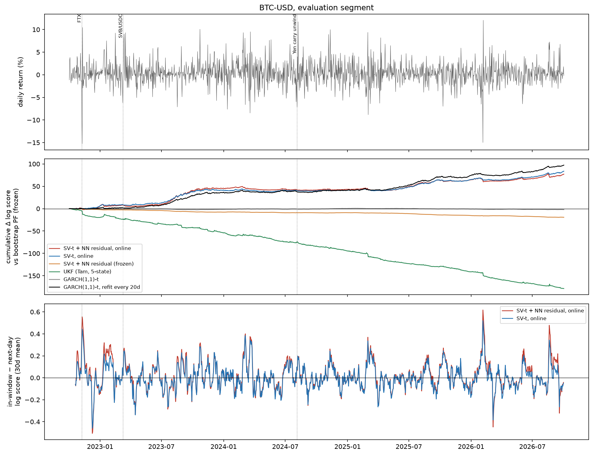

# Online differentiable particle filters on financial data

Two experiments with online-learning differentiable particle filters (OL-DPF):

1. **E1: reproduction.** I re-ran the multivariate linear-Gaussian experiment of Li, Chen & Li (2023), *Learning Differentiable Particle Filter on the Fly*, with the authors' code.
2. **E2: extension to Bitcoin.** I applied online, unsupervised particle-filter learning to daily BTC-USD returns and compared it with classical filters and GARCH, with a probe for overfitting.

The original OL-DPF implementation is by Jiaxi Li, Xiongjie Chen and Yunpeng Li (MIT License). See [Attribution](#attribution-and-changes) and [`UPSTREAM_README.md`](UPSTREAM_README.md).

## E1: reproduction of Table I (d = 2)

10 seeds (the paper uses 50); online-stage test RMSE, mean ± sd over seed × window (`results/e1/table1_dim2.md`):

| Method | Paper (Table I) | Reproduced |
|---|---|---|
| Pre-trained DPF | 5.30 ± 3.51 | 3.27 ± 1.55 |
| OL-DPF | 1.83 ± 1.47 | 1.97 ± 0.68 |
| DPF (oracle) | 1.00 ± 1.23 | 1.55 ± 0.81 |

All three are within the paper's reported spread. The paper's ranking reproduces with paired tests on the same seeds:
- OL-DPF beats the pre-trained DPF on 8 of 10 seeds (paired t-test p = 0.009);
- the oracle beats OL-DPF on 10 of 10 seeds (p = 3e-4).

The gaps between methods are smaller than published.

## E2: Bitcoin

A stochastic-volatility particle filter (log-volatility AR(1), Student-t returns; optionally a small zero-initialised neural residual on the transition) is updated online by one Adam step per day on a sliding-window likelihood, following Li et al.
- **Fitting and tuning:** first year only, Oct 2021 – Sep 2022.
- **Walk-forward evaluation:** 1,462 days, Oct 2022 – Oct 2026.

Full details are in [`e2/README.md`](e2/README.md).

| Model | One-step log score / day | CRPS ×100 |
|---|---|---|
| GARCH(1,1)-t, refitted every 20 days | **2.385** | **1.277** |
| SV-t particle filter, online | 2.376 | 1.290 |
| SV-t + neural residual, online | 2.371 | 1.291 |
| Bootstrap PF, SV-t, frozen | 2.318 | 1.320 |
| GARCH(1,1)-t, fitted once | 2.317 | 1.311 |
| SV-t + neural residual, frozen | 2.305 | 1.328 |
| GARCH(1,1)-N, fitted once | 2.198 | 1.383 |
| 5-state UKF ([Bitcoin-UKF](https://github.com/tm3023/Bitcoin-UKF)) | 2.196 | 1.472 |

Comparisons below are daily log-score differences with 95% block-bootstrap confidence intervals.

**Online adaptation helps.** Compared with the same model frozen it gains +0.057/day [+0.032, +0.082], and against the UKF +0.179/day.

**It does not beat a regularly refitted GARCH-t.** The difference is −0.009 [−0.021, +0.001], a statistical tie.

**The neural residual adds nothing out of sample.** Online, it changes the score by −0.005 [−0.016, +0.006]; frozen, it makes it worse by −0.013 [−0.017, −0.010].

**It also overfits sliding windows.** In-window fit minus next-day score is +0.014 [+0.006, +0.022] higher than for the plain model, most visibly around the FTX collapse.



## Repository layout

```
e2/                      E2 code: data/split/scoring (common.py), UKF and GARCH baselines (baselines.py),
                         SV-t particle filter and online learning (dpf.py), driver (run_e2.py), README
results/e1/              E1 tables, logs, run scripts, environment freeze
results/e2/              E2 tables, tuning, per-seed walk-forward results, overfitting probe
results/table_main.md    E2 main table (copy)
results/fig_regime.png   E2 figure (copy)
OL-DPF-gaussian/         Upstream linear-Gaussian experiment (with the small changes listed below)
OL-DPF-tracking/         Upstream tracking experiment (unchanged)
UPSTREAM_README.md       Original README of the upstream repository
```

## Reproduce

```bash
python -m venv .venv && .venv/Scripts/python -m pip install -r requirements.txt
# E1 (CUDA GPU required by the upstream code), one method at a time:
bash results/e1/run_one.sh online 0        # also: pretrain, supervised
cd OL-DPF-gaussian && ../.venv/Scripts/python e1_summarise.py --dim 2
# E2 (CPU). Needs data/btc_usd_close_2021-10-02_2026-10-02.csv (BTC-USD daily close from Yahoo Finance,
# not redistributed here; see Bitcoin-UKF's diagnostics.py, which downloads and caches it):
cd e2 && ../.venv/Scripts/python run_e2.py tune && ../.venv/Scripts/python run_e2.py main && ../.venv/Scripts/python run_e2.py report
```

Long runs checkpoint as they go (per seed for E1; per grid point and per variant/seed for E2) and resume where they stopped.

## Attribution and changes

The OL-DPF implementation is by Jiaxi Li, Xiongjie Chen and Yunpeng Li ([upstream repository](https://github.com/JiaxiLi1/Online-Learning-Differentiable-Partiacle-Filters), MIT License, copyright (c) 2023 JiaxiLi1; see [`LICENSE`](LICENSE)), accompanying:

> Li, J., Chen, X., & Li, Y. (2023). Learning Differentiable Particle Filter on the Fly. *57th Asilomar Conference on Signals, Systems, and Computers*. arXiv:2312.05955.

Upstream itself builds on Le, Igl, Rainforth, Jin & Wood (2018), *Auto-Encoding Sequential Monte Carlo*, ICLR.

Changes from upstream commit `3bb6d23`:
- `OL-DPF-gaussian/arguments.py`, `test_losses.py`:
  - new `--num_experiments` option (default 50, the upstream value) and `--seed_start` option (default 0);
  - each seed's RMSE/ELBO arrays are saved to `logs/.../per_seed/seed_<i>.npz` as soon as the seed finishes.

  Training and evaluation are unchanged.
- `OL-DPF-gaussian/e1_summarise.py`, `results/e1/`: new, for the E1 reproduction.
- `e2/`, `results/e2/`, `results/table_main.md`, `results/fig_regime.png`: new, for the E2 Bitcoin experiment. The E2 code is a separate, self-contained implementation following the same online-learning scheme; it does not import the upstream package.
- `README.md` (this file) is new; the original is preserved unchanged as `UPSTREAM_README.md`.

Environment used: Windows 11, Python 3.13, PyTorch 2.14.1+cu126 on an NVIDIA RTX 3050 Laptop GPU (upstream used Ubuntu 22.04, Python 3.7 and an RTX 3090).

## Use of AI tools

Parts of this repository (experiment code, scripts, documentation) were written with the help of an AI coding assistant (Claude, Anthropic), working to my specification and decisions; commits co-authored by the assistant are marked "Co-Authored-By: Claude". I chose the experiments, checked the results and am responsible for the conclusions.
